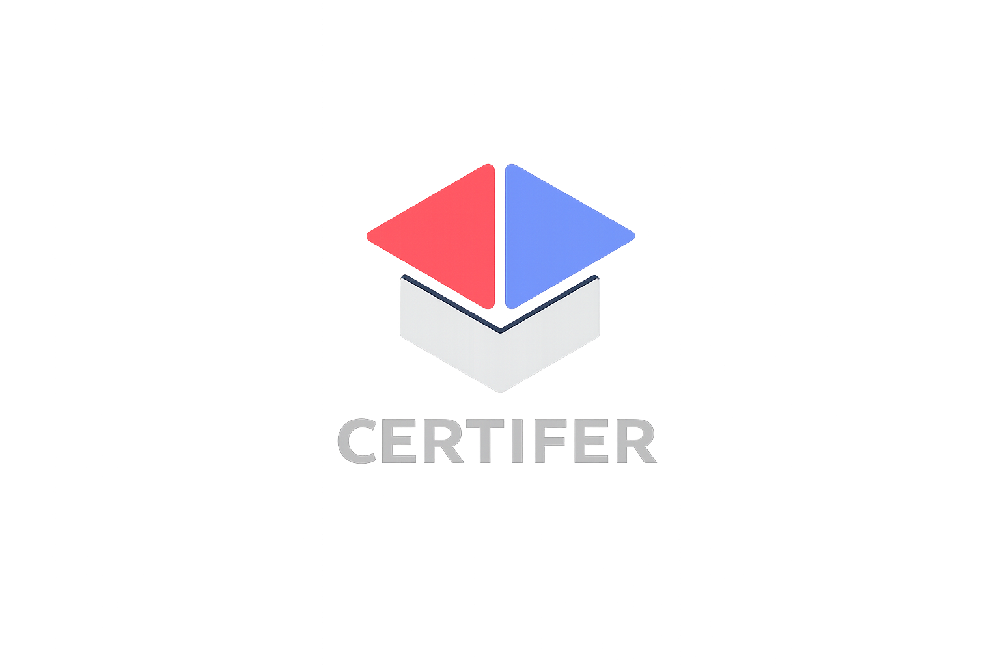

<div align="center">



# CertiFer · Cursos Online

### Plataforma web de catálogo de cursos con autenticación, filtros y carrito de compra

**Proyecto Full Stack · Vue 3 · PHP · MySQL/MariaDB**


[](#estado-del-proyecto)
[](#tecnologías)
[](https://github.com/fmoorenoo/cursos_online)

</div>

---

## Sobre el proyecto

**CertiFer** es una aplicación web para descubrir y explorar cursos online. Ofrece un catálogo con categorías, búsqueda y filtros, fichas de cursos, carrito y formularios de autenticación.

La interfaz se desarrolla con **Vue 3**, cargado desde CDN, **JavaScript** y **CSS**. El backend utiliza **PHP con PDO** y una base de datos **MySQL/MariaDB** para consultar cursos y gestionar registro e inicio de sesión.

> Es un **proyecto de desarrollo y demostración**. El flujo actual de compra es simulado: no hay una pasarela de pago ni procesamiento de cargos reales en el código revisado.

## Funcionalidades

- **Catálogo de cursos:** consulta de la oferta almacenada en la base de datos.
- **Búsqueda, filtros y paginación:** filtrado por tipo, disponibilidad de certificado y precio máximo; paginación de resultados.
- **Carrusel de destacados:** presentación de una selección de cursos.
- **Detalle de cada curso:** información específica del contenido seleccionado.
- **Carrito de compra:** incorporación y retirada de cursos, con persistencia mediante `localStorage`.
- **Registro e inicio de sesión:** endpoints PHP con consultas preparadas y verificación de contraseñas mediante `password_verify`.
- **Interfaz multilingüe:** recursos de internacionalización en JavaScript.
- **Personalización visual:** selección de paletas de colores y navegación adaptable a dispositivos móviles.
- **Compra de demostración:** comprobaciones de sesión y disponibilidad, aviso de éxito y vaciado del carrito, **sin cobro real**.

Las funcionalidades anteriores se han contrastado con la estructura del repositorio y el código fuente. No se ha ejecutado una prueba integral con la base de datos durante esta revisión.

## Tecnologías

| Área | Tecnologías |
| --- | --- |
| **Frontend** | HTML5 · CSS3 · JavaScript |
| **Framework de interfaz** | Vue 3 (CDN) |
| **Backend** | PHP |
| **Base de datos** | MySQL/MariaDB |
| **Acceso a datos** | PDO · sentencias preparadas |
| **Autenticación** | `password_hash` · `password_verify` |
| **Estado local** | Vue · `localStorage` |
| **Recursos UI** | Font Awesome · hojas de estilos modulares |

## Arquitectura

```text
cursos_online/
├── index.html                  # Interfaz principal de CertiFer
├── css/                        # Estilos por componentes y secciones
├── js/
│   ├── app.js                  # Aplicación Vue y estado principal
│   ├── i18n.js                 # Textos y traducciones
│   ├── palettes.js             # Paletas visuales
│   └── methods/                # Métodos de UI, carrito y autenticación
├── backend/
│   ├── conexion.php            # Conexión PDO mediante variables de entorno
│   ├── getCursos.php           # Consulta del catálogo
│   ├── init.sql                # Esquema y datos iniciales
│   └── auth/
│       ├── login.php           # Acceso de usuario
│       ├── register.php        # Registro
│       └── getClientes.php     # Consulta relacionada con clientes
├── assets/                     # Logo, imágenes e iconografía
└── .gitignore
```

El navegador presenta la interfaz Vue y solicita información a los endpoints PHP. Estos utilizan PDO para comunicarse con la base de datos. El carrito se almacena en el navegador del usuario, no en una tabla de pedidos confirmados.

## Diseño y recursos

<div align="center">
  
  <p><sub>Logotipo del proyecto incluido en el repositorio.</sub></p>
</div>

El proyecto dispone de recursos gráficos, pero no se han localizado capturas verificadas de la aplicación completa en el repositorio. Se podrán incorporar posteriormente imágenes de la portada, el catálogo y el carrito.

## Instalación y ejecución

**Requisitos:** servidor web con **PHP 8 o superior** y **MySQL/MariaDB**. El código utiliza `str_starts_with`, disponible desde PHP 8.

1. Clona el repositorio:

   ```bash
   git clone https://github.com/fmoorenoo/cursos_online.git
   cd cursos_online
   ```

2. Crea una base de datos de desarrollo e importa el archivo `backend/init.sql`. El script incluye estructura y datos de ejemplo.
3. Crea un archivo `.env` en la **raíz del repositorio**, utilizado por `backend/conexion.php`:

   ```dotenv
   DB_HOST=localhost
   DB_NAME=tienda_cursos
   DB_USER=tu_usuario
   DB_PASS=tu_contrasena
   ```

4. Configura permisos y credenciales de la base de datos local.
5. Inicia el servidor PHP desde la raíz:

   ```bash
   php -S localhost:8000
   ```

6. Abre `http://localhost:8000/` en el navegador.

**Importante:** no subas el archivo `.env` con credenciales reales a GitHub. Esta guía orienta la configuración local; no se ha verificado una instalación completa durante la revisión.

## Estado del proyecto

**Proyecto Full Stack de desarrollo / demostración.** El repositorio incluye frontend, endpoints backend y SQL de inicialización.

### Aspectos técnicos a tener en cuenta

- **Pagos:** la función `checkout()` del carrito simula la confirmación y no registra un pedido pagado ni se integra con una pasarela.
- **Sesiones y autenticación:** conviene revisar el sistema completo de gestión de sesiones y autorizaciones antes de un despliegue público.
- **Seguridad del backend:** `conexion.php` puede devolver detalles de errores de conexión; en producción deberían registrarse de forma interna sin exponer información sensible.
- **Datos de ejemplo:** revisar los registros incluidos en `init.sql` antes de distribuirlos o reutilizarlos.
- **Pruebas:** no se han verificado pruebas automatizadas, despliegue productivo ni integración completa durante esta revisión.

## Autor

**Fernando Montelongo Moreno** · Full Stack Developer · DAM + DAW

[](https://github.com/fmoorenoo)
[](https://www.linkedin.com/in/fernando-montelongo/)

---

<div align="center">
  <sub>CertiFer · Catálogo de cursos online con Vue, PHP y MySQL</sub>
</div>
